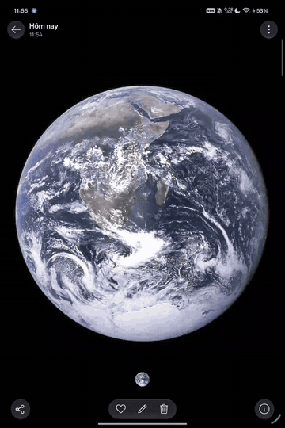

# Screen Lens

Restores a partial **Circle to Search** (circle an area to search it with Google Lens) on **ColorOS China-ROM** devices, where the feature is blocked at the ROM level. No root required.

## Demo



[Full-quality video (MP4)](docs/media/screen-lens-demo.mp4). Recorded on the test device with the touch indicator turned on. The photo is NASA's public-domain "The Earth seen from Apollo 17". The app was started with an adb command in this recording, which does the same thing as tapping its icon. Lens shows Vietnamese text because the device language is Vietnamese; the result describes southern Africa and Madagascar, the area that was circled.

## What it does

On Oppo's China ROM, long-pressing Home/the gesture bar or the power button only starts the Breeno assistant, never Gemini or Circle to Search. On an Oppo Pad Mini (OPD2515, ColorOS 17 CN) I found:

- SystemUI's `google_assistant_supported` flag is `false` on a read-only partition, and the long-press gesture is hard-wired to Breeno.
- There is no `contextual_search` system service, so Circle to Search has no backend to run on.
- The non-root options (assistant role, `KEYCODE_ASSIST`, the `VOICE_COMMAND` intent, circulated `settings` keys) had no effect on this build.

Screen Lens is the closest thing that works **without root**:

1. Launch the app (for example from the ColorOS smart sidebar).
2. It captures the current screen through an accessibility service.
3. You **draw a freehand stroke** around what you want to search. A quick tap searches the whole screen.
4. It crops to the stroke's bounding box and hands the image to **Google Lens**.

It is not identical to Google's Circle to Search: Lens opens full screen instead of a floating result sheet, and the stroke only chooses the crop. The Home/power long-press gesture is **not** restored. A full restore needs root, for example the LSPosed module [ColorOS-Assistant-Restore](https://github.com/Andrea-lyz/ColorOS-Assistant-Restore) (reported by that project to work on ColorOS 17 CN; I have not verified it myself).

## Privacy

The app declares no permissions, including INTERNET. Screenshots live in the app's private cache and are only readable by the Google app while being sent to Lens. Old screenshots are deleted on the next capture. The accessibility service only uses the screenshot capability (`canTakeScreenshot`); it does not read screen content or events.

## Install and setup

Tested on: **Oppo Pad Mini OPD2515, ColorOS 17.0.0.104 (CN01), Android 17**. Requires Android 11+ (`minSdk 30`). Other devices are untested.

1. Download `screen-lens-1.0-debug.apk` from [Releases](../../releases) (or the [`apk/`](apk) folder) and install it. The APK is signed with the debug key. If you install it from a file manager or browser, Android asks you to allow that app to **install unknown apps**.
2. Turn the service on: **Settings > Accessibility > Screen Lens**, switch it **on**. This is the only switch the app needs.
3. Make sure the **Google app** (which provides Google Lens) is installed and Google services work. Lens fetches a sign-in token from Google Play services, so it needs a network path to Google.
4. Add the "Screen Lens" icon to the smart sidebar or home screen and tap it to use.

### Switches checklist

| Setting | Needed? | Notes |
| --- | --- | --- |
| Accessibility > Screen Lens | **Required** | Without it the app cannot capture the screen, and tapping the icon opens Accessibility settings instead. |
| Allow restricted settings | Only if step 2's switch is greyed out | On Android 13+ an app installed from outside a store can have accessibility locked. Go to **Settings > Apps > Screen Lens**, open the **⋮** menu at the top right, choose **Allow restricted settings**, then try step 2 again. Not seen on the test device, which was installed through adb. |
| Background activity / auto-start, lock in recents | Recommended | ColorOS may force-stop the app, which turns the service off (see Troubleshooting). Names and paths vary by ColorOS version. |
| VPN or Wi-Fi toggle | Only if Lens says "no network" | See Troubleshooting. |
| Draw over other apps, storage, camera, notifications | **Not needed** | The app declares no permissions. The selection screen is a normal full-screen activity, not an overlay. |
| Breeno, gesture navigation, other assistant settings | **Leave as they are** | The app does not change them. |

To stop using it, switch the service off in Accessibility or uninstall the app. The app writes nothing outside its private cache.

The app UI is available in English and Vietnamese (Follow system / English / Tiếng Việt). Tap the gear in the corner of the selection screen to change it.

## Troubleshooting

**Tapping the app opens Accessibility settings.** ColorOS force-stopped the app and Android dropped the service from the enabled list. Turn it on again by hand, or with adb:

```bash
adb shell settings put secure enabled_accessibility_services \
  dev.binh.lensbubble/dev.binh.lensbubble.LensBubbleService
adb shell settings put secure accessibility_enabled 1
```

If ColorOS ignores the first write, run it a second time. In Settings > Apps > Screen Lens allow background activity/auto-start and lock the app in the recents screen to make it less likely to be stopped.

**Lens opens but says "no network".** On the test device, ColorOS's Battery app (`com.oplus.battery`) set a `REJECT_ALL` policy on Google Play services after its boot-time Google probe failed. Check with:

```bash
adb shell service call networking_control 2 i32 <uid of com.google.android.gms>
```

A value of `00000004` means it is blocked. Toggling Wi-Fi off and on makes Battery probe again and lifts the block. A running VPN makes the probe skip. This is an observation from one device and has not been checked on others.

## Build from source

Needs JDK 17+ and the Android SDK (platform 36).

```bash
echo "sdk.dir=/path/to/Android/Sdk" > local.properties
./gradlew assembleDebug
# APK: app/build/outputs/apk/debug/app-debug.apk
```

Plain Java, no third-party dependencies.

## License

[MIT](LICENSE). This is an unofficial project, not affiliated with Google or Oppo. "Google", "Lens" and "Circle to Search" are trademarks of their respective owners.
